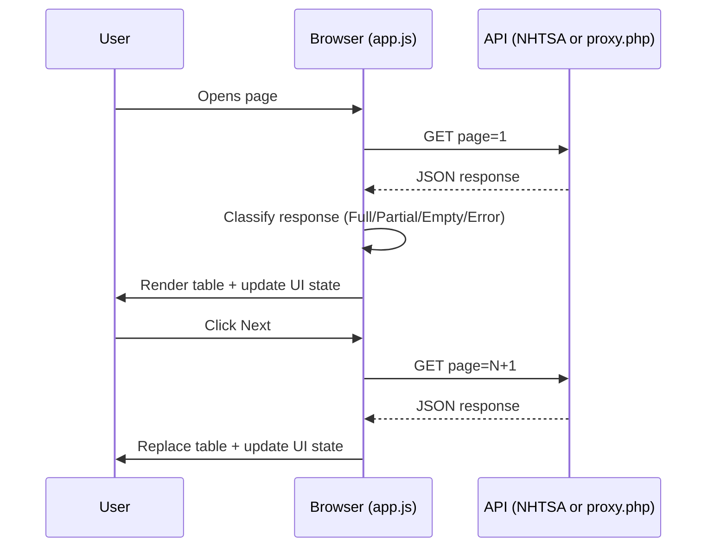

# Design Document

## Overview

The Manufacturers Browser is a three-file static web application (`index.html`, `css/style.css`, `js/app.js`) that fetches and displays vehicle manufacturer records from the NHTSA public vPIC API on demand. An optional fourth file, `proxy.php`, is deployed only if the browser is blocked from reaching the API directly due to CORS restrictions.

The application has no build step, no dependencies, and no framework. It is deployed by FTP to a shared Apache host at `public_html/traffic/` (or equivalent). All asset references are relative so the app works at any subdirectory depth.

The core interaction loop is:
1. On load, fetch page 1 automatically.
2. Render results in a three-column table (Name, Country, Vehicle Types).
3. Allow the user to navigate forward and backward one page at a time using Previous/Next buttons.
4. Detect the last page by observing the API response (Partial Page or Empty probe).
5. Surface loading, error, and empty-dataset states through an ARIA live region.

---

## Architecture

```
index.html
  └─ css/style.css         (linked via relative path)
  └─ js/app.js             (linked via relative path, deferred)

proxy.php                  (conditional — only if CORS fails)
```

### Request flow



### Data source selection

A named constant `USE_PROXY` (boolean) at the top of `app.js` controls which URL is used. Setting it to `false` (the default) uses `API_BASE_URL`; setting it to `true` uses `PROXY_URL`. This switch must be flipped manually after the CORS test described in Assumption A1 of the requirements.

---

## Components and Interfaces

### HTML skeleton (`index.html`)

The page contains one visible content region inside `<main>`. Key structural elements:

```
<body>
  <header>
    <h1>Vehicle Manufacturers</h1>
  </header>
  <main>
    <nav aria-label="Page navigation">
      <button id="btn-prev" type="button" disabled>Previous</button>
      <span id="pagination-label">Loading…</span>
      <button id="btn-next" type="button" disabled>Next</button>
    </nav>

    <div id="status" role="status" aria-live="polite" aria-atomic="false"></div>

    <table>
      <thead>
        <tr>
          <th scope="col">Name</th>
          <th scope="col">Country</th>
          <th scope="col">Vehicle Types</th>
        </tr>
      </thead>
      <tbody id="table-body"></tbody>
    </table>
  </main>
</body>
```

**Element responsibilities:**

| Element | ID / role | Purpose |
|---|---|---|
| `<nav aria-label="Page navigation">` | — | Pagination landmark (Req 11.1) |
| `<button id="btn-prev">` | `btn-prev` | Previous page trigger; native `<button>` (Req 11.2–3) |
| `<span id="pagination-label">` | `pagination-label` | Current page display (Req 10) |
| `<button id="btn-next">` | `btn-next` | Next page trigger; native `<button>` (Req 11.2–3) |
| `<div id="status" role="status" aria-live="polite">` | `status` | ARIA live region for loading/error/empty messages (Req 11.5) |
| `<tbody id="table-body">` | `table-body` | Replaced wholesale on each page load |
| `<th scope="col">` | — | Semantic column headers (Req 11.4) |

The `disabled` attribute is set/removed programmatically by `evaluateButtons()`. No inline event handlers appear in the HTML.

---

### CSS architecture (`css/style.css`)

**Approach:** mobile-first. Base styles target the narrowest supported viewport (320 px). A single breakpoint at 600 px widens padding and font size for larger screens.

**Key layout decisions:**

- The `<table>` uses `table-layout: fixed` with `width: 100%` so columns fill the viewport and do not overflow horizontally.
- Column widths are distributed proportionally (e.g., Name wider, Country and Vehicle Types narrower). Exact proportions are an implementation detail.
- `<td>` and `<th>` use `word-break: break-word` or `overflow-wrap: break-word` to handle long manufacturer names without forcing horizontal scroll.
- The `<nav>` (pagination controls) uses flexbox for horizontal centering of Previous, label, and Next.

**Breakpoints:**

| Viewport | Behaviour |
|---|---|
| 320 px and above (base) | All three columns visible, no horizontal scrollbar |
| Below 600 px | Reduced cell padding and reduced font size so all columns fit; touch targets for buttons ≥ 44 × 44 CSS px |
| 600 px and above | Normal padding and font size |

**Touch target sizing (below 600 px):** `btn-prev` and `btn-next` must have `min-height: 44px` and `min-width: 44px` (Req 12.3). This is enforced in the base styles so it applies at all widths (safe: larger screens have no minimum constraint violated by this).

**Key class / selector names:**

| Selector | Purpose |
|---|---|
| `#status` | Status area container; hidden when empty via `display: none` or empty content check |
| `.status--loading` | Modifier applied while fetch is in flight |
| `.status--error` | Modifier applied on fetch failure |
| `.status--empty` | Modifier applied on empty-dataset response |
| `#btn-prev`, `#btn-next` | Navigation buttons |
| `#pagination-label` | Page indicator |
| `table` | Manufacturer data table |
| `tbody#table-body` | Replaced on every render |

---

### JavaScript architecture (`js/app.js`)

The entire script is wrapped in an **IIFE** (Immediately Invoked Function Expression) to avoid global variable pollution. No ES module syntax is used. The entire app is a single file with no cross-file imports, so the IIFE keeps things simple without requiring a bundler or module-aware tooling.

#### Constants

```
API_BASE_URL   string   "https://vpic.nhtsa.dot.gov/api/vehicles/GetAllManufacturers?format=json&page="
PROXY_URL      string   "proxy.php?page="
USE_PROXY      boolean  false   // flip to true after CORS test fails
REQUEST_TIMEOUT_MS  number   10000
```

`USE_PROXY` determines which URL prefix is used when constructing the request URL. The active URL is computed as:
```
(USE_PROXY ? PROXY_URL : API_BASE_URL) + requestedPage
```

#### State variables

All five state variables live inside the IIFE closure. No state is stored in the DOM or in `localStorage`.

| Variable | Type | Initial value | Description |
|---|---|---|---|
| `currentPage` | integer | 0 | 1-based page number of the last successfully loaded response. 0 before any page has loaded and when the dataset is confirmed empty. |
| `requestedPage` | integer | 1 | Page number being fetched or about to be fetched. Equals `currentPage` when idle. |
| `failedPage` | integer \| null | null | Page number captured at the moment of a fetch failure. Null when idle. |
| `lastPageKnown` | boolean | false | True once boundary detection has confirmed the last page. |
| `lastConfirmedPage` | integer \| null | null | Page number confirmed as the last page. Meaningful only when `lastPageKnown` is true. |

#### DOM element references

Captured once at IIFE initialisation time:

```
btnPrev         — <button id="btn-prev">
btnNext         — <button id="btn-next">
paginationLabel — <span id="pagination-label">
statusDiv       — <div id="status">
tableBody       — <tbody id="table-body">
```

#### Named functions

**`fetchPage(page)`**
- Parameters: `page` (integer, 1-based).
- Sets `requestedPage = page`.
- Constructs the request URL using the active URL prefix constant.
- Creates an `AbortController`. Sets a `setTimeout` for `REQUEST_TIMEOUT_MS` that calls `controller.abort()`.
- Calls `fetch(url, { signal: controller.signal })`.
- On response: clears the timeout, reads and parses JSON.
- Classifies the response (Full / Partial / Empty / Error) and calls the appropriate handler.
- On any failure (network error, abort, non-2xx, malformed JSON): calls `handleError(error)`.
- Calls `showStatus("Loading…", "loading")` before the fetch and clears it on success.
- Calls `evaluateButtons()` at the start (to disable during flight) and on every outcome.

**`renderTable(results)`**
- Parameters: `results` (array of Manufacturer Record objects).
- Clears `tableBody.innerHTML`.
- Iterates `results`, constructing one `<tr>` per record with three `<td>` cells.
- Display Name logic: uses `Mfr_CommonName` if non-null and non-empty; otherwise uses `Mfr_Name`.
- Vehicle Types logic: joins `VehicleTypes[].Name` with `", "`. Empty string when array is empty.
- Country logic: uses `Country` if non-null and non-empty; otherwise empty string.
- Cell values are assigned via `td.textContent = value`, never via `innerHTML`, to prevent XSS from API-supplied strings.
- After inserting all rows, moves keyboard focus to the first `<td>` in `tableBody` (Req 11.7). Does **not** move focus on the initial page load — only on user-triggered navigation.

**`renderPagination()`**
- No parameters.
- Reads `currentPage` from closure state.
- Sets `paginationLabel.textContent` according to the rules in Req 10:
  - `"Loading…"` — set externally before fetch, not by this function.
  - `"No data"` — when `currentPage === 0`.
  - `"Page N"` — all other cases (N = `currentPage`).
- Called only after `currentPage` has been updated to its new value.

**`showStatus(message, type)`**
- Parameters: `message` (string), `type` (`"loading"` | `"error"` | `"empty"` | `""` to clear).
- Clears any existing modifier class from `statusDiv`.
- Sets `statusDiv.textContent = message` (or clears it).
- Applies the appropriate modifier class (`.status--loading`, `.status--error`, `.status--empty`).
- When `type === "error"`, also appends a `<button>` (the Retry button) to `statusDiv`. The Retry button is a native `<button>` element (Req 11.6).
- When `type === ""`, removes the Retry button if present.

**`evaluateButtons()`**
- No parameters.
- Reads: `currentPage`, `requestedPage`, `lastPageKnown`, `lastConfirmedPage`, and `fetchInFlight` (a boolean flag set during fetch).
- Applies the six priority rules (P1–P6) in order to set `btnPrev.disabled` and `btnNext.disabled`.
- Called after every state change: fetch start, fetch success, fetch failure, retry initiation.

**`handleSuccess(data)`**
- Parameters: `data` (parsed Page Response JSON).
- Before accessing any fields, verifies that `data.Results` is an Array and `data.Count` is a non-negative integer. If validation fails, calls `handleError` with a structure-invalid error. This guard is applied at the pipeline level (step 10 above) before `handleSuccess` is called, so `handleSuccess` may assume the data is structurally valid.
- Extracts `Count` and `Results` from `data`.
- Classifies response: Full (Count === 100), Partial (1 ≤ Count ≤ 99), Empty (Count === 0).
- Dispatches to boundary detection logic.
- On Full or Partial: calls `renderTable(data.Results)`, sets `currentPage = requestedPage`, calls `renderPagination()`.
- On Empty probe (requestedPage > 1): does **not** call `renderTable`; leaves table and label unchanged.
- On Empty page 1: calls `renderTable([])` (empty table), calls `showStatus(…, "empty")`.
- Per-record validation: for each record in `data.Results`, verify `Mfr_Name` is a non-empty string. Records that fail this check are skipped silently (logged to console); they do not cause the entire response to fail.
- Calls `evaluateButtons()`.

**`handleError(error)`**
- Parameters: `error` (Error object or fetch rejection reason).
- Records `failedPage = requestedPage`.
- Reverts `requestedPage = currentPage`.
- Determine message:
  - `error.name === "AbortError"` → `"Request timed out after " + (REQUEST_TIMEOUT_MS / 1000) + " seconds."`
  - `error.message` starts with `"HTTP error:"` → use `error.message` directly (e.g., `"HTTP error: 503"`)
  - `error.message === "Response structure invalid."` → use `"Response structure invalid."`
  - `error.message` non-empty → use `error.message`
  - Otherwise → `"Network request failed."`
- Calls `showStatus(message, "error")`.
- Calls `evaluateButtons()`.

**`handleRetry()`**
- No parameters. Attached as click handler to the Retry button rendered by `showStatus`.
- Sets `requestedPage = failedPage`.
- Calls `showStatus("", "")` to clear the error and remove the Retry button.
- Calls `fetchPage(requestedPage)`.
- On success: clears `failedPage = null` (handled inside `handleSuccess`).

---

## Data Models

### Page Response (API JSON)

```
{
  Count:          integer   // number of records in Results; max 100
  Message:        string    // human-readable status message from API
  SearchCriteria: null      // always null for GetAllManufacturers
  Results:        ManufacturerRecord[]
}
```

### Manufacturer Record

```
{
  Mfr_ID:         integer
  Mfr_Name:       string          // always present
  Mfr_CommonName: string | null   // preferred display name; may be null or empty string
  Country:        string | null   // may be null or empty string
  VehicleTypes:   VehicleType[]   // may be empty array
}
```

### Vehicle Type

```
{
  IsPrimary:  boolean
  Name:       string
}
```

### Response classification

| Count value | Classification | Meaning |
|---|---|---|
| 100 | Full Page | Dataset continues beyond this page |
| 1–99 | Partial Page | This page is the last page |
| 0 | Empty Response | Probe went past last page (or dataset is empty if page = 1) |

### Display Name derivation

```
DisplayName =
  if Mfr_CommonName is non-null AND non-empty string
    → Mfr_CommonName
  else
    → Mfr_Name
```

### Vehicle Types String derivation

```
VehicleTypesString =
  if VehicleTypes.length === 0
    → ""
  else
    → VehicleTypes.map(vt => vt.Name).join(", ")
```

---

## Correctness Properties

*A property is a characteristic or behavior that should hold true across all valid executions of a system — essentially, a formal statement about what the system should do. Properties serve as the bridge between human-readable specifications and machine-verifiable correctness guarantees.*

### Property 1: Display Name derivation is deterministic

*For any* Manufacturer Record, the Display Name SHALL equal `Mfr_CommonName` when it is a non-null, non-empty string, and SHALL equal `Mfr_Name` in all other cases.

**Validates: Requirements 2.2, 2.3**

---

### Property 2: Vehicle Types String derivation is deterministic

*For any* array of VehicleType objects, the rendered Vehicle Types String SHALL be the empty string when the array is empty, and SHALL equal the `Name` values joined in order by `", "` when the array is non-empty. The derivation is a pure function: the same input array always produces the same string.

**Validates: Requirements 2.4, 2.5**

---

### Property 3: Table row count matches results array length

*For any* Page Response, the number of `<tr>` elements rendered in `<tbody>` SHALL equal the length of the `Results` array.

**Validates: Requirements 2.7, 3.2, 4.2**

---

### Property 4: Button state is fully determined by the five state variables

*For any* combination of (`currentPage`, `requestedPage`, `lastPageKnown`, `lastConfirmedPage`, `fetchInFlight`), calling `evaluateButtons()` SHALL produce a unique, deterministic disabled/enabled state for each button, consistent with the P1–P6 priority rules.

**Validates: Requirements 6.1, 6.2**

---

### Property 5: Previous button is always disabled on page 1

*For any* application state where `currentPage === 1` and no fetch is in flight, the Previous button SHALL be disabled.

**Validates: Requirements 6.1**

---

### Property 6: Next button state at confirmed last page is governed by rule P3

*For any* application state where `evaluateButtons()` is called, rule P3 (`lastPageKnown === true && currentPage === lastConfirmedPage`) SHALL disable Next when it is the highest-priority matching rule for Next. Rule P3 is only reached when P1 (in flight) and P2 (empty dataset) do not match. Backward navigation to a page with `requestedPage < lastConfirmedPage` returns a Full Page that does NOT satisfy the boundary-invalidation condition (`requestedPage >= lastConfirmedPage`), so `lastPageKnown` remains `true` and P3 continues to govern Next when the user returns to the confirmed last page.

**Validates: Requirements 6.1, 5.1, 5.2**

---

### Property 7: Pagination label reflects current page after every successful navigation

*For any* sequence of navigation actions that each return a successful Page Response, the pagination label SHALL read `"Page N"` where N equals `currentPage` after each action completes.

**Validates: Requirements 10.1, 10.5**

---

### Property 8: Error state preserves last successful table contents

*For any* application state where the table has been successfully rendered at least once, a subsequent fetch failure SHALL leave the table contents unchanged.

**Validates: Requirements 9.8**

---

## Error Handling

### Error handling matrix

| Error type | Trigger condition | Display message | Sets `failedPage` |
|---|---|---|---|
| Network error | `fetch()` rejects with a `TypeError` | `"Network request failed."` (or `error.message` if non-empty) | Yes |
| Non-2xx HTTP status | `response.ok === false` | `"HTTP error: {status}"` (e.g., `"HTTP error: 503"`) | Yes |
| Malformed JSON | `response.json()` throws | `"Response could not be parsed."` | Yes |
| Timeout | `AbortController.abort()` fires after `REQUEST_TIMEOUT_MS` ms | `"Request timed out after {REQUEST_TIMEOUT_MS / 1000} seconds."` | Yes |

All four error types display the error message in `#status` and render a Retry button. `failedPage` is always set to the value of `requestedPage` at the time of failure. After setting `failedPage`, `requestedPage` is reverted to `currentPage`.

### Timeout implementation note

`AbortController` is used to cancel the in-flight `fetch()` call. The abort fires via `setTimeout(controller.abort, REQUEST_TIMEOUT_MS)`. When `fetch()` rejects because of an abort, the error's `name` property equals `"AbortError"`. The error handler checks `error.name === "AbortError"` to produce the timeout-specific message rather than the generic network error message.

### Fetch-in-flight guard

A boolean flag `fetchInFlight` (initial value: `false`) is set to `true` immediately before `fetch()` is called and reset to `false` in the `finally` block of the fetch pipeline. This flag feeds directly into `evaluateButtons()` rule P1. It also prevents the Next/Previous click handlers from initiating a new fetch while one is already running.

---

## Testing Strategy

### Scope

This application is vanilla JavaScript with no module bundler or test runner configured. Formal automated testing is out of scope for the initial deployment. The testing strategy focuses on manual test cases and property-based reasoning that can be converted to automated tests in a future iteration if a test harness is introduced.

### Why property-based testing is not applied here

This feature is primarily I/O-driven: all meaningful behaviour involves DOM manipulation (which cannot be meaningfully tested with PBT without a full browser environment), `fetch()` calls to an external API, and imperative state transitions triggered by user events. There are no pure transformation functions whose correctness across a wide input space benefits from property randomisation.

The Display Name and Vehicle Types String derivations (Properties 1–2) are pure functions and are the best candidates for lightweight unit tests, but their input spaces are small enough that a handful of concrete examples cover all branches. The correctness properties above are documented for completeness and to guide any future test automation.

### Manual test checklist

**Initial load**
- [ ] Page loads and fetches page 1 automatically; table shows 100 rows.
- [ ] Pagination label shows "Loading…" during fetch, then "Page 1".
- [ ] Previous button disabled; Next button enabled after load.

**Forward navigation**
- [ ] Clicking Next fetches page 2; table is replaced; label shows "Page 2".
- [ ] Both buttons disabled during fetch.
- [ ] Previous enabled after reaching page 2.

**Backward navigation**
- [ ] Clicking Previous from page 2 fetches page 1; table replaced; label shows "Page 1".
- [ ] Previous disabled again after returning to page 1.

**Boundary detection**
- [ ] On the last page (Partial Page response), Next is disabled.
- [ ] Navigating back from last page re-enables Next (Full Page re-enables it; `lastPageKnown` resets if a Full Page is received with `lastPageKnown === true`).

**Error and retry**
- [ ] Simulated network failure (DevTools offline mode): error message shown, Retry button rendered, table unchanged.
- [ ] Retry button clears error, shows Loading, re-fetches.
- [ ] Non-2xx response (throttled/test): HTTP status code appears in error message.
- [ ] Timeout: abort fires after `REQUEST_TIMEOUT_MS`; timeout message shown.

**Display Name fallback**
- [ ] Row with non-null `Mfr_CommonName` shows common name in Name column.
- [ ] Row with null `Mfr_CommonName` shows `Mfr_Name` in Name column.

**Accessibility**
- [ ] Tab order reaches Previous, Next, and Retry (when present) without mouse.
- [ ] Screen reader announces loading/error messages via live region.
- [ ] Focus moves to first data cell after page navigation.

**Responsive**
- [ ] At 320 px viewport width, no horizontal scrollbar; all three columns visible.
- [ ] At 375 px (typical mobile), Previous/Next buttons have ≥ 44 × 44 px touch target.

---

## Button State Machine

### State decision table

The `evaluateButtons()` function evaluates Previous and Next **independently**. Rules P0 and P1 apply to both buttons. Rules P3 and P4 apply to Next only. Rules P5 and P6 apply to Previous only. For each button, evaluation stops at the first rule that produces a match for that button. A rule marked "—" for a button is simply skipped when evaluating that button.

| Priority | Rule | Condition | Previous | Next |
|---|---|---|---|---|
| P0 | No data loaded | `currentPage === 0 && !fetchInFlight` | DISABLED | DISABLED |
| P1 | In flight | `fetchInFlight === true` | DISABLED | DISABLED |
| P3 | Last page confirmed | `lastPageKnown === true && currentPage === lastConfirmedPage` | — | DISABLED |
| P4 | Probe permitted | most recent Count for currentPage was 100 | — | ENABLED |
| P5 | First page | `currentPage === 1` | DISABLED | — |
| P6 | Default previous | `currentPage > 1` | ENABLED | — |

Note: P0 and P1 are evaluated in order. P0 catches the pre-load and confirmed-empty-dataset state; P1 catches the in-flight state. The old P2 ("Empty dataset: currentPage === 0") is subsumed by P0 and removed as a separate rule.

"—" means this rule does not affect that button; evaluation continues to the next rule for that button.

### Boundary detection state transitions

| Response type | Condition | State changes |
|---|---|---|
| Partial Page (1–99) | any page | `lastPageKnown = true`, `lastConfirmedPage = requestedPage`, Next disabled |
| Empty Response | `requestedPage > 1` | `lastPageKnown = true`, `lastConfirmedPage = requestedPage - 1`, `requestedPage` reverted; table/label unchanged |
| Empty Response | `requestedPage === 1` | `lastPageKnown = true`, `lastConfirmedPage = 0`, `currentPage = 0`, table empty, label "No data", both buttons disabled |
| Full Page (100) | `lastPageKnown === true` AND `requestedPage >= lastConfirmedPage` | `lastPageKnown = false`, `lastConfirmedPage = null`, Next enabled. Only fires when the full-page result is received for a page at or beyond the previously confirmed boundary. Backward navigation to earlier pages never resets the boundary. |

---

### Complete state-transition table

The table below covers every significant scenario, showing the application state before and after each event. Column headers: `cP` = `currentPage`, `rP` = `requestedPage`, `fP` = `failedPage`, `lpK` = `lastPageKnown`, `lcP` = `lastConfirmedPage`, `inFlight` = `fetchInFlight`. "→" separates before/after values; "=" means unchanged.

| Scenario | Event | cP before→after | rP before→after | fP before→after | lpK before→after | lcP before→after | inFlight before→after | Table | Label |
|---|---|---|---|---|---|---|---|---|---|
| **App opens** | DOMContentLoaded fires | 0→0 | 1→1 | null→null | false→false | null→null | false→true | empty | "Loading…" |
| **Initial load — Full Page** | response: Count=100 | 0→1 | 1→1 | null→null | false→false | null→null | true→false | empty→100 rows | "Loading…"→"Page 1" |
| **Initial load — Partial Page** | response: Count=61 | 0→1 | 1→1 | null→null | false→true | null→1 | true→false | empty→61 rows | "Loading…"→"Page 1" |
| **Initial load — error** | fetch rejects or non-2xx | 0→0 | 1→1 | null→1 | false→false | null→null | true→false | empty (unchanged) | "Loading…"→"Page 1" |
| **Initial load — empty dataset** | response: Count=0, rP=1 | 0→0 | 1→1 | null→null | false→true | null→0 | true→false | empty | "Loading…"→"No data" |
| **Navigate Next — Full Page** | user clicks Next; response: Count=100 | N→N | N→N+1→N+1 | null→null | false→false | null→null | false→true→false | N rows→N+1 rows | "Page N"→"Page N+1" |
| **Navigate Next — Partial Page (boundary found)** | user clicks Next; response: Count=K (1–99) | N→N | N→N+1→N+1 | null→null | false→true | null→N+1 | false→true→false | N rows→K rows | "Page N"→"Page N+1" |
| **Navigate Next — Empty probe (past last page)** | user clicks Next; response: Count=0, rP>1 | N→N | N→N+1→N | null→null | false→true | null→N | false→true→false | N rows (unchanged) | "Page N" (unchanged) |
| **Navigate Previous — Full Page, lpK=false** | user clicks Previous; response: Count=100 | N→N | N→N-1→N-1 | null→null | false→false | null→null | false→true→false | N rows→N-1 rows | "Page N"→"Page N-1" |
| **Navigate Previous — Full Page, lpK=true, rP < lcP** | user clicks Previous from page < lastConfirmedPage; Count=100 | N→N | N→N-1→N-1 | null→null | true→true | lcP→lcP | false→true→false | N rows→N-1 rows | "Page N"→"Page N-1" |
| **Navigate Previous — Full Page, lpK=true, rP >= lcP** | user clicks Previous (edge: rP lands on confirmed page); Count=100 | N→N | N→N-1→N-1 | null→null | true→false | lcP→null | false→true→false | N rows→N-1 rows | "Page N"→"Page N-1" |
| **Fetch error during navigation** | user clicks Next or Previous; fetch fails | N→N | N→N±1→N | null→N±1 | =→= | =→= | false→true→false | N rows (unchanged) | "Page N" (unchanged) |
| **Retry — success** | user clicks Retry; response successful | N→N | N→fP→fP | fP→null | =→= | =→= | false→true→false | N rows→fP rows | "Page N"→"Page fP" |
| **Retry — failure (repeated)** | user clicks Retry; fetch fails again | N→N | N→fP→N | fP→fP | =→= | =→= | false→true→false | N rows (unchanged) | "Page N" (unchanged) |
| **Backward nav after boundary, then Next probe** | back to page N-1 (full page, rP < lcP) then Next | N→N-1 | N→N-1 | null→null | true→true | lcP→lcP | false→true→false | rows→N-1 rows | "Page N"→"Page N-1" |

**Notes:**
- "N rows" means the rows from the most recently successfully loaded page.
- `failedPage` (fP) is captured from `requestedPage` at the moment of failure, before `requestedPage` reverts.
- The "Retry — failure (repeated)" row shows that `failedPage` is re-set to the same value (`fP`) on each consecutive failure, so repeated retries always target the same page.
- "Navigate Previous — Full Page, lpK=true, rP >= lcP" is an edge case that occurs only if `lastConfirmedPage` was set to a page the user can navigate back *to* via Previous (e.g. confirmed last page = 2, user goes back to page 1, then clicks Next to page 2 which returns full page — boundary resets).

---

## Fetch Pipeline

The complete fetch sequence for a single `fetchPage(page)` call uses one outer `try/catch/finally` that covers every async step, including `AbortError` thrown during body consumption.

```
Setup (before try):
  1. Set fetchInFlight = true
  2. Set requestedPage = page
  3. Call showStatus("Loading…", "loading")
  4. Call evaluateButtons()                    ← P1 fires; both buttons disabled
  5. Create AbortController
  6. const timeoutId = setTimeout(() => controller.abort(), REQUEST_TIMEOUT_MS)

try:
  7. const response = await fetch(url, { signal: controller.signal })
       url = (USE_PROXY ? PROXY_URL : API_BASE_URL) + page
       ↳ Throws on network error or AbortError (including abort during body read)
  8. if (!response.ok) throw new Error("HTTP error: " + response.status)
  9. const data = await response.json()
       ↳ Throws SyntaxError on malformed body; AbortError if body stalls past timeout
 10. Validate structure:
       - data.Results must be an Array
       - data.Count must be an integer, 0 ≤ Count ≤ 100
       - data.Count must equal data.Results.length
       ↳ if any check fails: throw new Error("Response structure invalid.")
 11. Call showStatus("", "")                   ← clear loading message
 12. Call handleSuccess(data)

catch (err):
 13. Call handleError(err)

finally:
 14. clearTimeout(timeoutId)
 15. Set fetchInFlight = false
 16. Call evaluateButtons()                    ← re-evaluates on every outcome
```

`clearTimeout`, `fetchInFlight = false`, and the final `evaluateButtons()` call always run regardless of outcome. `handleError` does not need to reset `fetchInFlight` because `finally` guarantees it.

---

## Accessibility Design

### ARIA live region

`<div id="status" role="status" aria-live="polite" aria-atomic="false">`

- `polite`: announcements wait for the user to finish their current interaction before reading.
- `aria-atomic="false"`: allows individual child elements to be announced independently (loading text and Retry button are separate nodes).
- Content is updated by `showStatus()` which sets `textContent` (or appends the Retry button). The live region is never hidden via `display: none` while it contains content — doing so would prevent announcement.

### Focus management

`renderTable()` moves focus to the first `<td>` in `tableBody` after a user-triggered navigation. Specifically:

```
const firstCell = tableBody.querySelector("td")
if (firstCell) firstCell.focus()
```

The first `<td>` does not have a static `tabindex` attribute in the HTML. `renderTable()` sets `tabindex="-1"` on it programmatically before calling `.focus()` so that the element is focusable without being in the natural tab order.

Focus management is **not** applied on the initial page load (no user action) and **not** applied after an error or empty-probe result (the table contents did not change).

---

## Proxy.php Design

`proxy.php` is a conditional file deployed only if the CORS verification step (Assumption A1) fails.

**Inputs:** `$_GET["page"]` — the page number to forward to the NHTSA API.

**Validation:** Cast to integer. Reject values outside 1–9999 (safe upper bound) with HTTP 400 and a JSON error body.

**Request forwarding:** Use `file_get_contents()` with a stream context that sets a `User-Agent` header. Fall back to `curl` if `allow_url_fopen` is disabled on the host. PHP 7.4+ compatible.

**Response:** Echo the raw NHTSA JSON body. Set headers:
```
Content-Type: application/json
Access-Control-Allow-Origin: *
```

**Error handling:** If the upstream request fails, return HTTP 502 with a JSON error body `{"error": "upstream request failed"}`.

**Size constraint:** Target under 30 lines, no framework, no Composer dependencies.

**`app.js` change:** When `USE_PROXY = true`, the fetch URL becomes `proxy.php?page=N` (relative, no origin prefix required).

---

## Open Decisions

The following items cannot be resolved in the design phase and require confirmation before or during implementation:

### OD-1: CORS availability (Assumption A1)

**Decision:** Whether to default `USE_PROXY` to `false` (direct API) or `true` (proxy).

**Resolution method:** During initial deployment, open browser DevTools and run:
```js
fetch("https://vpic.nhtsa.dot.gov/api/vehicles/GetAllManufacturers?format=json&page=1")
  .then(r => r.json()).then(console.log).catch(console.error)
```
from the production origin (`https://pereiravictor.com/traffic/` or equivalent). If this succeeds, `USE_PROXY` stays `false` and `proxy.php` is not deployed. If it fails with a CORS error, flip `USE_PROXY = true` and deploy `proxy.php`.

**Impact:** If the proxy is required, Assumption A3 must also be resolved: the existing `getAllManufacturers.php` proxy only returns page 1. It must be replaced or updated to accept a `page` parameter before the app is fully functional.

### OD-2: AbortController + fetch abort behaviour across browsers

**Decision:** Whether the `AbortError` name check (`error.name === "AbortError"`) reliably distinguishes timeouts from other fetch rejections across all target browsers (Chrome, Firefox, Safari, Edge).

**Context:** All modern evergreen browsers support `AbortController` and reject the fetch promise with a `DOMException` named `"AbortError"` when `abort()` is called. This is well-established behaviour. However, in some environments, `error.name` may instead be `"AbortError"` on the `DOMException` or as a plain string on a polyfill. Since no polyfill is in use, this is expected to be safe, but should be confirmed with a quick manual test during implementation.

**Resolution method:** In the initial test deployment, manually trigger a timeout (set `REQUEST_TIMEOUT_MS` to 100 ms temporarily) and verify the timeout message appears rather than the generic network error.
